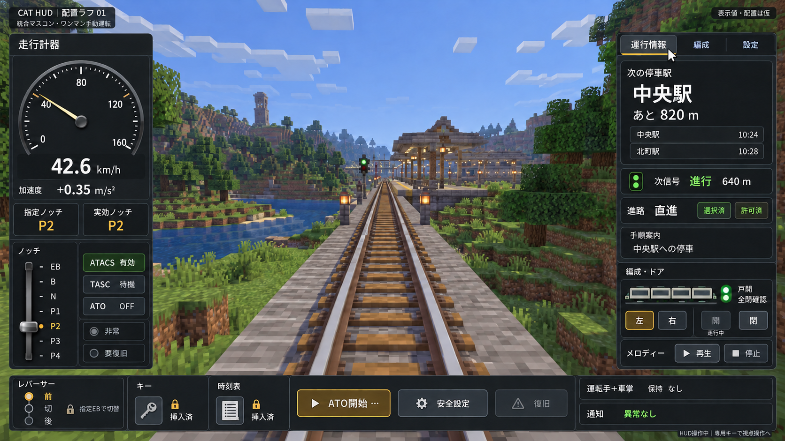

# マスコンHUD レイアウトラフ 01

作成日：2026-10-18

状態：AI生成の配置検討用ラフ。未実装・未承認のデザイン案。実機スクリーンショットではない。



## 想定した場面

- 統合マスコンを使ったワンマン手動運転。運転手・車掌を兼任している例。
- 走行速度42.6 km/h、加速度+0.35 m/s²、指定P2／実効P2、レバーサー前。
- ATACS有効、TASC待機、ATO OFF、非常・要復旧なし、全閉確認、保持なし。
- 専用キーによるHUDカーソル操作中。通常時は視点操作へ戻る構想。
- 駅名・時刻・距離・編成長・ノッチ段数・表示値は説明用の仮データ。列車性能や計算結果を示すものではない。

## 現在の整理3.mdから反映した点

参照：[整理3.md](../../整理3.md) 第11章、8.23・8.25節。

- 左・右・下をHUDとし、中央から上に前方の景色を残す（11.1節）。
- 左に速度・加速度・指定ノッチ／実効ノッチ・自動運転／安全状態をまとめ、運行情報を見る間も表示を維持する（11.8・11.14節）。
- 右に駅情報、次信号と距離、選択済／許可済の区別、手順案内、編成・ドアを配置する。手順案内と次駅表示は別枠にする（11.6～11.7・8.25節）。
- 下に前／切／後の縦方向レバーサー、キー・時刻表枠、ATO開始等の操作、通知領域を配置する（11.9～11.10・8.23節）。
- 走行中の開扉は無効表示にし、閉扉と区別する。戸閉表示と進路許可も別にする（11.20節）。
- 非常灯と要復旧灯を別々に表示する（11.14節）。
- ワンマンの兼任を「運転手＋車掌」として表示する（11.19節）。

## このラフで仮置きした点

- 配色、各パネルの寸法、余白、文字サイズ、具体的な配置、ノッチの表現は未承認。
- ホットバー非表示の例。非表示を既定に決める意味ではない。
- レバーサー・キー／時刻表枠のロック表示は、例示した走行状態に対応する見た目。
- ボタンの細かな有効条件、クリック・ドラッグ、EBへの追加操作、画面切替・終了手順は静止画では表現しきれていない。表示だけで操作仕様の確認済みとはしない。
- 4両の編成図とP1～P4の表示は部品配置の例。特定プロファイルや編成長の固定ではない。
- 背景のMinecraft風景・信号・線路も生成画像。画角・視認距離・ブロック数と表示距離の一致を検証したものではない。
- 処理・描画・文字・画像素材の実装、Minecraftでの表示や動作確認は行っていない。

## 生成方法・プロンプト

組込みimage_genを使用。初回生成後、背景の信号とHUDの進行表示が整合するよう、背景信号のみ修正する編集を行った。採用した画像をこのフォルダへ保存した。

### 初回生成プロンプト

```text
Use case: ui-mockup.
Create one landscape 16:9 raster mock screenshot, preferably 1920x1080 or higher with the same ratio, of a Minecraft Java Edition train-driving HUD for the Create Advanced Trains mod (CAT). This is a reviewable layout rough, not a real gameplay capture. Render a believable vanilla-like Minecraft voxel world viewed from the front of a train: Create-style railway tracks leading into the distance, blocky grass and trees, a simple station ahead, daylight. The world must be recognizably Minecraft, but the OVERLAID 2D GUI must have smooth antialiased graphics, elegant fine readable Japanese typography, crisp clean instrument needles and restrained charcoal panels. No photorealistic real-world train cab, no human hands, no physical dashboard. Medium fidelity UI design mockup with aligned rectangular panels and minimal decoration, not a marketing poster.

Critical layout based on current requirements:
- Leave the central and upper forward view unobstructed. Most of the top quarter is just game scenery. Reserve a wide clear central corridor, about 55% screen width, from near the top to 82% screen height. Keep at least roughly 60% of the image as visible scenery.
- A narrow left instrument panel (about 20% width), narrow right information panel (about 23% width), and a shallow bottom operating strip (about 14% height). Panels hug the screen edges with 16px margins. Main landscape visible between them. No central modal, no central floating card.
- Small top-left badge, exact text: "CAT HUD｜配置ラフ 01". Small sublabel: "統合マスコン・ワンマン手動運転". Small top-right badge "表示値・配置は仮". These are compact, not a giant title.
- Show cursor-operation mode as a tiny footer "HUD操作中｜専用キーで視点操作へ". Draw one white cursor hovering over the right panel tab "運行情報"; no tooltip overlay across the world.
- For this mockup only, the vanilla hotbar is hidden. Do not show health, hunger, XP, minimap or random debug overlays.

LEFT PANEL:
Title "走行計器".
One prominent round analog speedometer with clean white face or dark face and bright ivory scale; thin smooth needle. Clear ticks and labels 0, 40, 80, 120, 160; scale monotonically clockwise with zero lower-left and 160 lower-right; needle MUST point to approximately 42.6 on that scale, just past 40, NOT to 80. Under it large digital "42.6" with "km/h".
Next line "加速度  +0.35 m/s²".
Two clearly separated boxes "指定ノッチ  P2" and "実効ノッチ  P2".
Below them, a compact vertical one-handle mascon diagram on the left half: discrete positions top to bottom EB, B, N, P1, P2, P3, P4. P2 handle position selected. EB position separated by a visible detent/gap; it is a lever position, not a standalone immediate-click emergency button. Label "ノッチ" above it. The range is only illustrative.
Beside the handle, compact status badges, exact text "ATACS 有効", "TASC 待機", "ATO OFF". Two separate unlit dark indicators "非常" and "要復旧". Do not light these red in this normal running example.

RIGHT PANEL:
Top tabs "運行情報" (selected), "編成", "設定".
Main station card: small label "次の停車駅", large "中央駅", "あと 820 m".
Small upcoming-stations list with two rows "中央駅  10:24" and "北町駅  10:28". These are fictional examples.
A separate clearly visible next-signal line with green signal icon and exact text "次信号  進行  640 m". Do not put green and stop in the same signal card.
Route row "進路  直進" with two distinct small status chips "選択済" and "許可済".
A compact section "手順案内" with one neutral entry "中央駅への停車". Keep it visually separate from the station card, no blocking popups.
A section "編成・ドア": simple small four-car outline and a green/amber door-closed lamp with text "戸閉  全閉確認".
Door controls: side selection chips "左" (selected) and "右"; button "開" MUST be greyed out with caption "走行中"; button "閉" visually enabled neutral. Door-closed indication is not labeled departure permission.
Compact "メロディー" with "再生" and "停止" controls.

BOTTOM STRIP:
Arrange a few well-spaced groups, no tiny dense rows.
Left group "レバーサー" with a VERTICAL three-position diagram "前", "切", "後". "前" selected; subtle lock icon and caption "指定EBで切替". Do not make this a horizontal left/right reverser.
Next distinct resource slots: "キー" with key icon and "挿入済"; "時刻表" with small paper icon and "挿入済". Their item removal is locked during running; use subtle lock marks.
Middle modest rectangular clickable buttons "ATO開始…" and "安全設定" and a disabled "復旧". These are illustrative action controls, not all simultaneously active.
Right status area shows "運転手＋車掌" and "保持 なし", with a reserved notification row "通知  異常なし".
No single-click red EB button and no default free exit control during driving.

Typography and style:
Japanese text must be correctly spelled, short, readable and laid out with real padding. Hierarchy: speed and next station most prominent; secondary values medium; supporting status smallest but legible. Neutral dark gray panel surfaces, soft ivory digits and thin lines, restrained green for valid states and amber for selections, inactive lamps gray. No neon cyberpunk styling, no ornamental huge HUD arcs, no web browser frame, no extra fictitious power/voltage/pressure gauges, no code, no API terminology, no implementation notes inside the player-facing controls. Keep the UI as a flat screen-space overlay aligned to display, never perspective-skewed.
Output one complete image only, no collage and no alternate versions.
```

### 信号表示の修正プロンプト

```text
Use case: precise-object-edit. Edit this CAT HUD layout mockup with ONE localized consistency correction: the small trackside railway signal visible in the Minecraft world, slightly left of image center and near the station, currently has a glowing RED lower lamp. Make this signal indicate PROCEED: turn its red lamp OFF so it is dark, and illuminate its upper green lamp. The HUD on the right already reads 「次信号 進行 640 m」 and should remain exactly unchanged. Preserve all panel positions, ALL Japanese text, numbers, typefaces, controls, needle position, viewport, terrain, lighting, and the entire rest of the image pixel-for-pixel as closely as possible. Do not rearrange or redesign anything. Do not add labels or arrows. Keep original wide aspect ratio and opaque background.
```

