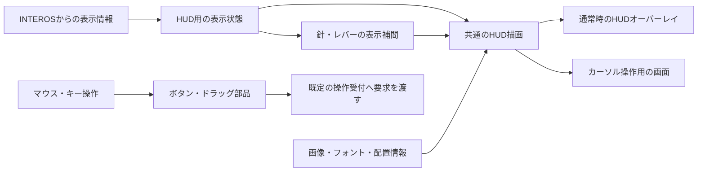

# マスコンHUDの描画・入力構成調査

調査日：2026-10-18

対象：Minecraft Java Edition 1.20.1／Forge 47.4.10／Create 6.0.8-289

位置付け：**調査結果と構成提案。採用済み設計・実装仕様ではない。**

## 1. 結論

**参考画像のような計器・表示灯・運行情報画面を、滑らかに動く針とクリック操作を持つ2DのマスコンHUDとして作ることは、技術的に十分現実的と考える。** MinecraftのHUDを16×16などの低解像度ドット絵に限定する必要はない。

第一候補は、**Minecraft／Forge標準のGUI機能＋高解像度の透過PNG＋表示専用の補間＋HUD操作用の画面**である。追加の大型GUIライブラリを必須にせず、文字の画質が不足する場合にModern UI等を比較する構成を提案する。

| 条件 | 実現の考え方 | 現時点での判断 |
| --- | --- | --- |
| 針やレバーを滑らかに動かす | 固定の目盛りに、独立した針画像を毎描画フレーム回転して重ねる。前後の表示値を補間する | 基盤機能とCreateの利用例を確認。実現性は高い |
| ドット絵のような粗さを避ける | 十分な解像度の画像、線形フィルタ、半透明の輪郭、適切な文字描画を組み合わせる | 実現性は高いが、細い目盛り・小さい日本語・拡大縮小時の品質は試作確認が必要 |
| 一部をクリック・ドラッグできる | 描画する部品に操作領域を対応させ、カーソル操作時だけ入力用の画面を使う | ボタン自体は標準機能で対応可能。視点操作との切替、キー操作継続、実アイテム枠は設計の難所 |

これはローカルソースと公式資料による構成上の評価である。**CAT上での画質、FPS、Createや描画系MODとの実機互換性を確認した結果ではない。** 画面の画素数を超えた精細さや、低FPS時まで一定の滑らかさを保証することはできない。

## 2. 今回の参照範囲

### 2.1 資料と作業の境界

- [整理3.md](../../整理3.md)の責任分担、マスコンHUD・入力、役割別操作、HUD参考の扱いを参照した。
- 依頼文の入力フォルダ名は「HUD関連」だったが、調査開始時点で画像が存在したのは[HUD参考](../HUD参考)だった。5車種・計13枚を目視確認した。本調査を保存するため「HUD関連」を新設し、参考画像は移動していない。
- Createは提供済みの`vendor/Create-mc1.20.1-6.0.8`を確認した。Minecraft／Forge／Catnipは既存のローカルGradleキャッシュ内の対象版ソースを確認した。
- WebではForge公式ドキュメント、ライブラリ作者の配布ページ、LWJGL公式API資料を確認した。外部プロジェクトの実装ソースの新規取得・閲覧は行っていない。
- 列車制御計算、通信方式、パケット形式、権限判定の実装は対象外。以下では画面が受け取る表示情報と、操作を渡す境界だけを示す。

### 2.2 「整理3.md」から維持する要件

| 現在の決定・境界 | 本調査への反映 | 参照節 |
| --- | --- | --- |
| マスコンは操作受付とHUD表示を担当し、情報はINTEROSから取得する | HUD内に列車制御計算を持たせず、表示と入力の層として扱う | 第3章・3.2節 |
| 左・右・下をHUDとし、中央から上に景色を確保する | 一枚の不透明な全画面パネルにせず、常設計器と情報・操作パネルを配置する | 11.1節 |
| 通常は視点操作。専用キーを押している間だけカーソル操作。切替式も選択可 | 通常表示とカーソル入力の二つの状態を分ける | 11.2節 |
| HUD操作中は視点を固定し、背後へクリックを通さない。ノッチキーは継続 | 標準ボタンを置くだけでは完了しない。専用の入力接続が必要 | 11.2～11.3節 |
| 指定ノッチと実効ノッチは別表示 | 滑らかに動くレバー画像と、実効状態の表示部品を分離する | 11.8節 |
| 実効ノッチの既定20tick表示周期は、速度・加速度・指定ノッチの周期ではない | 速度計を1秒ごとのコマ送りにしない | 11.8節 |
| EB・TASC等の状態変化は通常の表示間隔を待たない | 警告・状態灯へ針用の遅い補間を流用しない | 11.8・11.14節 |
| 手動の正常HUD終了には条件があり、Escは最前面だけへ作用する | カーソル画面の終了と、マスコン利用そのものの終了を分ける | 11.4～11.5節 |
| 運転手・車掌・閲覧者で操作範囲が違う | 共通部品を使い、表示・有効化・理由表示を役割に応じて変える | 11.19節 |
| 参考画像は基本思想の参考。全計器・電圧／圧力系の採用は未決定 | 写っているすべての計器やボタンを実装対象へ追加しない | 11.22節 |

旧「同一台HUDは一人限定」や、一律NへのATO解除などの見直し対象を、今回の構成提案で現行仕様へ戻すことはしない。

## 3. 参考画像をどう分解するか

確認した画像は、山手線E235系0番台、京浜東北線E233系1000番台、東海道線E233系3000番台、常磐線E531系0番台の全体・左右各画像と、総武線快速E217系の全体画像である。

| 画像で見える部分 | CATのHUDでの表現候補 |
| --- | --- |
| 計器の外枠、パネルの質感、固定目盛り | 静止した背景画像・目盛り画像 |
| 速度計等の針 | 背景が透明な独立画像を、決めた支点の周りで回転 |
| 数字、駅名、時刻、説明 | 背景とは別の文字描画。速度等の数字だけ専用字形画像にすることも可能 |
| 段階表示、状態灯、色の付いたバー | 点灯用部品の切替、着色、描画範囲の変更 |
| 編成とドアの図 | 車両・ドアの小部品を並べ、状態ごとに切替 |
| 下端のボタン、タブ | ボタンの見た目と、クリック判定・フォーカスを対応させる |

画像から判断できるのは見た目と配置であり、元のシミュレーターの描画方式やクリック可能範囲までは分からない。

**画像内の斜めの液晶画面を、そのまま斜めのCAT画面にする必要はない。** 正面向きの2Dパネルへ再構成した方が、文字の読みやすさと操作領域の管理に向く。参考画像の拡大部分は約430～590px幅で、既に針・文字・照明・遠近が重なっているため、配布用HUD画像の元データとして拡大するより、部品を分けた新しい素材を用意する方が適切である。

運転台全体の立体形状や、視点移動で変わる遠近・反射まで再現する場合は、ワールド内3Dモデルと動的な画面描画を含む別の構成になる。本調査の第一候補は画面上の2D HUDであり、3D運転台の完全再現を確認したものではない。

## 4. 使用するAPI・ライブラリの候補

### 4.1 第一候補：Minecraft／Forge標準＋既存のCreate関連機能

| 機能 | 候補 | 役割と根拠 |
| --- | --- | --- |
| HUDを描く場所の登録 | Forge `RegisterGuiOverlaysEvent`／`IGuiOverlay` | 通常のゲーム画面にHUDを重ねる。対象版に存在し、Createの列車HUDも利用している |
| 画像・文字・枠・クリッピング | Minecraft `GuiGraphics` | 画像、文字、矩形、スクロール領域等の基盤。Minecraft標準機能 |
| 針の回転・部品の移動／拡大縮小 | Minecraft `PoseStack` | 針の支点を基準に変換して描画する。小数を保った変換を使える |
| クリック・ドラッグ・キー入力 | Minecraft `Screen`、`GuiEventListener`、`AbstractWidget`等 | 入力用の画面と部品の土台。外観はCATの画像で独自に描ける |
| 表示値の補間 | 自前の小さな表示用補間、またはCatnip `LerpedFloat` | Catnipは現在のPonder依存内で確認でき、Createの`TrainHUD`でも使用。別のアニメーションMODを必須にする必要はない |
| 通常文字のフォント | Minecraftの名前付きフォントリソースとTTFプロバイダー | 対象版にTTF、`size`、`oversample`等が存在する。CATの文字だけを別フォントにする構成候補 |
| キー等の実アイテム枠 | 必要な箇所では`AbstractContainerScreen`／`AbstractContainerMenu`系を検討 | アイコンを描くだけのボタンと、実アイテムを移動できる枠は別物。詳細は第7節 |

Forge公式にも、`GuiGraphics`による描画と、画面・ウィジェットのマウス／キーボード入力が説明されている。[Forge 1.20.1 GUI資料](https://docs.minecraftforge.net/en/1.20.1/gui/screens/)

Create 6.0.8の`TrainHUD`は、`LerpedFloat`の更新と描画時の`getValue(partialTicks)`を組み合わせている。ただし速度表示用の入力を18段階に丸め、描画幅も整数化している。**参考にするのは描画と補間の接続方法であり、この丸め方や速度の正規化をCATの針へコピーする提案ではない。**

Flywheelは現在のCreate依存に含まれるが、この画面上の2D HUDを作るための中心ライブラリとして選ぶ必要はない。Create標準HUDの画像を差し替えるだけでCAT全体を作るより、CATの独立した表示・入力層として組み立てる方が現在の責任分担に合う、というのが本調査の提案である。

### 4.2 画質を上げるための追加候補

| 候補 | 向いている用途 | 今回の評価 |
| --- | --- | --- |
| **Modern UI／Modern Text Engine** | 小さい文字、拡大縮小される文字、滑らかな図形を含むGUI | 有力な比較候補。作者ページでアンチエイリアス・SDF文字描画等を案内し、Forge 1.20.1向け配布も確認できる。ただしCATとCreate 6.0.8での接続・互換性は未検証 |
| **LWJGL NanoVG** | 針・目盛り・曲線等を実行時のベクター描画で作りたい場合 | 技術候補だが初期案としては優先しない。描画機能に加え、入力・レイアウト・Minecraftとの描画状態の連携を別途用意する必要がある |

Modern UIについては、作者の[機能説明](https://modrinth.com/mod/modern-ui)と、Forge／Minecraft 1.20～1.20.1対応を明記した[3.12.0.1の配布ページ](https://modrinth.com/mod/modern-ui/version/3.12.0.1)を確認した。これは対応版が存在する証拠であり、その版をCATへ採用する決定や、当該組合せで全機能が動く保証ではない。

Modern UIは文字以外にも背景ぼかしやGUI倍率等の機能を持つ。導入時には、景色を明瞭に残すCATの操作画面、ゲームを止めない動作、他の描画・文字MODとの設定を確認する必要がある。作者ページにも一部MODとの調整事項があるため、「導入するだけですべて解決する」とは評価しない。

NanoVGについては、LWJGL公式資料でアンチエイリアス付きのOpenGL向けベクター描画機能を確認した。[LWJGL NanoVG資料](https://javadoc.lwjgl.org/org/lwjgl/nanovg/package-summary.html)

ただし、ローカルのMinecraft 1.20.1標準依存一覧はLWJGL 3.3.1で、`lwjgl-nanovg`は含まれていなかった。追加するなら、対象環境に合うモジュールとネイティブライブラリ、描画状態の復元等の検討が必要になる。現在のWeb API資料は別版であり、それだけから1.20.1への組込み手順を確定しない。Modern UI／NanoVGの実装ソースは今回ローカルに用意されておらず、内部構造の評価はしていない。

**推薦する選び方：まず標準GUIで素材・文字・針の品質を評価し、可変倍率の小さい日本語等が不足する場合にModern UIを比較する。** 画像主体の計器だけを理由に、新しい描画基盤を最初から追加する必要性は低い。

## 5. 画像を滑らかに見せる構成

### 5.1 高解像度PNGと拡大縮小

Minecraft 1.20.1の`GuiGraphics`には、描画先の寸法、切り出す領域、元テクスチャの寸法を指定する画像描画がある。256×256を前提とした短い呼出しもあるが、**GUI画像全体が256×256以下に制限されているわけではない。** 実際の上限はGPUやリソース量等にも依存する。

素材の解像度は、GUI設定上の座標数ではなく、**画面上で最大何ピクセルに表示するか**から決める。

- 例：速度計の最大表示径を約400～500画面ピクセルと想定するなら、512～1024px四方の目盛り画像を比較する。これは制作開始時の例であり、決定値ではない。
- 制作元はSVG等の編集可能な形式で保持し、使用サイズに合うPNGへ書き出す。標準の画像描画へSVGを渡すだけで、そのまま描けるとは扱わない。
- 大きい素材を少し縮小する方が、粗い素材を大きく拡大するより細部を残しやすい。ただし、非常に大きい素材を大幅縮小するだけでは細線のちらつきや欠落を解決できない。
- 画面を小さくしたときは、文字まで無制限に縮めず、情報パネルのページ分け等を使う。中央の景色と計器の可読性を同時に確保する。

### 5.2 線形フィルタと透過境界

対象版のローカルソースでは、独立した画像を読む`SimpleTexture`がPNGに付くメタデータの`blur`・`clamp`を読み、画像の転送時にフィルタへ反映している。`blur`の既定値はfalseであり、trueでは線形フィルタが使われる。

したがって、CAT専用のGUI画像では次の方針を候補にできる。

1. 各PNGに対応する`.png.mcmeta`の`texture`設定で、`blur`をtrueにして線形フィルタを使う。必要に応じて`clamp`も設定する。
2. 針や円周の輪郭には半透明画素を持たせ、適切なアルファ合成で重ねる。
3. 複数部品を1枚の画像にまとめる場合は、切り出し境界に余白・適切な縁の色を設ける。隣の部品の色や黒い縁が混ざるのを避ける。
4. 画像を再読込した場合も同じ設定にする。文字や他MODの共有テクスチャを一括してぼかす設計にはしない。

ここでの`blur`は、画面全体をぼかすエフェクトではなく、画像を拡大縮小するときの補間設定である。独立GUI画像の読込みで確認した事実であり、ブロック／アイテムのアトラスやフォントへ同じ設定がそのまま適用されるという意味ではない。

**線形フィルタだけで全描画にアンチエイリアスが付くわけではない。** 元画像にない細部は復元できず、細すぎる線は最終表示で消える。画像ではなく図形として描く円周や斜線には、別途輪郭処理が必要になる場合がある。

必要ならHUD部分を大きめの描画先へ描いて縮小する方法（スーパーサンプリング）も比較できる。ただし追加の描画量と描画先管理が必要で、低解像度の文字画像を単に拡大するだけでは改善しない。この方式は候補に留め、初期の必須構成にはしない。

### 5.3 文字は画像と別に評価する

背景が滑らかでも、標準のビットマップ風の文字をそのまま使えば文字だけにドット感が残る。

- **固定の目盛り・単位**：目盛り画像へ焼き込む方法が使える。倍率を変える場合の最小サイズは確認する。
- **速度等の数字**：TTFで描くほか、0～9・小数点・符号等を高解像度で用意した数字用画像から組み立てる方法もある。
- **駅名・理由・説明・可変の日本語**：日本語を含むフォントを用意し、文字として描く。すべての駅名を画像にする構成は適さない。
- **多言語化するラベル**：原則として背景に文字を焼き込まず、文言と見た目を分けておく。

標準TTFプロバイダーは字形を画像化して使用するため、「TTFに変えれば、どんな倍率でも完全に滑らか」とは言えない。`size`・`oversample`・表示倍率・字の太さを実際に比較し、不足する場合にModern UI等を検討する。

小さい日本語を大量に並べると、どの方式でも画面の情報密度が限界になる。参考画像と同じ情報量を常に同じ面積へ収めることを優先するより、必要な情報を読める大きさに保つ方がよい。

## 6. 針・レバーの滑らかな動き

推奨する見た目の構成は、**静止した計器盤＋回転する針＋中央の軸カバー＋必要な文字**である。速度ごとの画像を大量に並べる方式は不要である。

Minecraftの通常の論理更新は20tick/秒だが、描画は表示FPSに応じて行われる。針は描画のたびに、前後の表示値と`partialTick`を使って途中の位置を描けばよい。Create 6.0.8と、既存のPonder 1.0.91内のCatnipには、この構成を支える利用例・補間機能がある。

ただし、**tick間の補間と、ネットワークから届く情報の間隔は別の問題**である。値がまばらに届く状態を`partialTick`だけで完全に解決することはできない。更新値を表示へ追従させる程度、許容する表示遅れ、情報が途切れた場合の表示は後の設計事項とする。

表示側では、次の区別を保つことを提案する。

| 表示対象 | 動かし方の方針 |
| --- | --- |
| 速度計の針、連続量のバー | 小数の位置・角度で補間し、毎フレーム描画する |
| 離散ノッチのレバー | 指定先は離散位置。そこへ移る見た目だけを滑らかにする |
| 数値の丸め・実効ノッチ | その表示規則に従う。針の角度を整数速度や整数描画座標へ不要に丸めない |
| EB、要復旧、情報不明、操作可否 | 受け取った状態を速やかに表示する。滑らかさのために警告の反映を遅らせない |

表示が遅れて追い付く演出を強くすると、速度計が実際の値より遅れる。補間・追従の量は見栄えだけで決めず、数値表示との整合も確認する必要がある。新しくHUDを開く、別列車へ切り替える、情報が無効になる場合には、以前の列車の針位置から不自然に長く移動させない。

ノッチアニメーションの時間、物理移行の10tick、実効ノッチの既定20tick表示周期を同一の設定として扱わない、という「整理3.md」の区別も維持する。

## 7. 全体構成とクリック対応

### 7.1 構成案

図は役割の案であり、クラス構成や通信方式の確定ではない。同じ計器描画を通常時と操作時で共有し、同一フレームに二重に描かないようにする。

配置は「左：常設計器」「右：運行・編成・詳細情報」「下：ノッチ等の操作と状態」という案が考えられるが、細部は未決定である。ページを変える場合も、速度・指定／実効ノッチ・非常／要復旧・重要な介入状態等を見失わない領域を維持する。

### 7.2 通常表示＋カーソル操作用Screen

| 状態 | 表示と入力の案 |
| --- | --- |
| 通常の運転・閲覧 | `IGuiOverlay`でHUDを表示し、通常のマウス視点操作を使う |
| 専用キーによるカーソル操作 | ゲームを一時停止しない透過の`Screen`を開き、同じHUDを表示する。マウスはこの画面で受ける |
| キーを離す／切替操作で戻る | 操作用の画面だけを閉じ、HUDを継続して視点操作へ戻る |
| 詳細・確認画面を表示 | 最前面へ入力を渡す。背後の重要な計器を見える配置にする |

単純なクリック・ホバー・ドラッグはMinecraftの画面／ウィジェットで扱える。ボタンの外観も標準の石調ボタンに限定されず、画像・文字・点灯表現を独自に描ける。

一方、**`Screen`を一枚開き、`isPauseScreen`をfalseにするだけでは全要件を満たさない。** これはゲームの一時停止を避ける指定であり、通常の視点操作やノッチキー入力を自動で維持する指定ではない。

ローカルのMinecraftソースでは、画面を開く際にマウスを解放し、キー状態を解放する。また、画面がない状態でマウスだけを解放しても、クリック時に通常のマウス捕捉へ戻る経路がある。したがって「カーソルを表示するだけ」の実装にはしない。

この構成で特に確認する点は以下である。

- カーソル表示のための画面開閉を、マスコンの利用終了・操縦権の解放と同一扱いにしない。
- 通常時と操作画面内の両方から、CATのノッチキーを同じ入力受付へ渡す。画面を開いた瞬間の長押し解除・キーを離した通知も扱う。
- HUD操作中のクリック・スクロールを背後へ渡さず、視点復帰時にマウス移動量が跳ねないようにする。
- ウィンドウのフォーカス喪失や画面切替で、ドラッグや押下状態を残さない。
- 文字入力中のノッチキーの扱いは「整理3.md」で未決定のため、今回決め打ちしない。
- 描画倍率、クリック判定、クリッピングに同じ配置情報を使う。画像だけ拡大し、クリック領域を元の寸法のままにしない。

Createの`InputEvents`には`screen != null`で通常の入力処理から戻る箇所がある。また、標準`ControlsHandler`はEscキーの実押下を見て操作終了する。**Createの標準入力へそのまま依存しても、CATの画面操作中のキー受付やEsc規則が自動的に満たされるとは言えない。** CATの入力層との境界を設ける必要がある。

常にScreenを使わず、HUDオーバーレイだけでカーソル・入力をすべて管理する方式も候補にはなる。ただしMinecraftのマウス捕捉、フォーカス、他画面との競合をより広く扱う必要があるため、今回の第一候補にはしない。

### 7.3 キー・時刻表のアイテム枠

「整理3.md」には、HUDのキー枠や時刻表の挿入・取出しもある。**実アイテムを出し入れする枠は、クリック可能な画像だけでは完成しない。**

見た目としてはHUDの中に枠を配置できるが、実際の持ち運び・プレイヤーの所持品とのやり取りを行う画面には、Minecraftのメニュー／コンテナ画面系を使う構成を別途検討する。単純な表示・操作画面すべてをコンテナ化する必要はない。

特に、カーソル操作を終えて視点へ戻ること、アイテム操作用の画面を閉じること、マスコン利用を終了することの関係は追加設計が必要になる。今回の調査では、通常ボタンと同程度の作業で完了するとまでは評価しない。

## 8. 用意する画像・素材

以下は制作物の候補であり、実際のファイル名・点数・仕様を確定するものではない。

| 素材 | 用意する内容 | 分ける理由 |
| --- | --- | --- |
| パネル背景・外枠 | 左・右・下などの背景。必要なら角・辺・中央を分ける | 画面サイズへ対応し、枠の太さを保ちやすくする |
| 計器の目盛り | 針を含まない目盛り、必要な固定数字・単位 | 針だけを回転できるようにする |
| 針 | 透過PNG。色・太さの違う針は必要に応じて別素材 | 滑らかな回転と差し替えを容易にする |
| 軸カバー・装飾 | 針の根元を覆う中央部、必要なら反射や枠 | 描画の重なりを管理する |
| レバー・操作溝・ノッチ目盛り | 動くレバーと、動かない台座・目盛りを分離 | 指定位置間の滑らかな移動に使う |
| ランプ・状態アイコン | 消灯・点灯・弱点灯、または共通の形と着色用部品 | 現在の状態灯要件を表現する。色だけで状態を伝えない |
| ボタン・タブ | 通常・カーソル重なり・押下・選択・無効の見た目 | クリックできる場所と現在状態を分かりやすくする |
| 編成・ドア部品 | 車両単位、ドア単位の小部品 | 編成長や状態に合わせて組み立てる |
| バー・マーカー | 加速度、残量、制限等に使う形状 | 数値に応じた長さ・位置・色の変化に使う |
| フォント | 日本語と必要な記号を含む再配布可能なフォント、数字用の別字形は任意 | 背景の画質と文字の画質を別々に調整する |

針画像には、画像寸法だけでなく、**回転支点、基準方向、表示する寸法**を合わせて記録する。ボタン等にも、配置の基準点と操作領域が必要である。こうした数値は後のレイアウト定義として持てばよく、実装コードへ大量の座標を散在させる必要はない。

初回の見た目確認に必要なのは、完成版すべての画像ではない。次の小さな組合せで、今回の三条件を先に評価できる。

1. 計器盤1枚、透過の針1枚、軸カバー1枚。
2. 背景パネル1種と、日本語・数字のサンプル文字。
3. 状態が変わるボタン1個と、ドラッグ可能なレバー1個。

画像は読込時にGPUへ転送し、描画中は再利用する構成を基本にする。針を動かすたびにPNGを生成・再読込する必要はない。大きな画像はメモリも使うため、一律に最大解像度へするより、必要な表示寸法に合わせる。

## 9. 難しい点・未確認事項

| 項目 | 難しさと現在の限界 |
| --- | --- |
| 高解像度素材と針の回転 | 一般的なGUI描画の範囲。実現性は高い。ただし実際の素材品質は別途必要 |
| 小さい日本語と細い目盛り | 高め。GUI倍率・ウィンドウ解像度・表示密度の影響が大きく、ライブラリの選択だけで解決しない |
| 視点／カーソル切替とノッチキー継続 | 高め。画面開閉・キー状態・マウス捕捉・Esc規則の接続が必要 |
| アイテム枠を含むHUD | 通常ボタンより難しい。メニュー系とHUD利用状態の関係が未設計 |
| Modern UIの採用 | 対象版の配布は確認済み。Create 6.0.8、CAT、描画系MODを含む動作は未確認 |
| 極端な縮小、低FPS、更新情報の欠落 | すべてを滑らか・精細に見せる保証はできない。最小文字サイズや不明表示等の方針が必要 |
| 写真のような3D運転台全体 | 2D HUDより範囲が広い。今回の調査で実現方式を確定していない |

後の小規模な表示試作では、速度計の低速な動き、斜めの針、小さい日本語、複数GUI倍率、カーソル切替中のノッチ操作、Escの一段戻りを確認するとよい。シングルプレイで画面操作中も列車が進むこと、フォーカスを失った後に押下が残らないこと、Create標準HUDとの重なりも確認対象になる。

今回、試作・ビルド・Minecraft起動・実機確認は実施していない。採用判断が必要なのは、まず目指す最小表示サイズと文字品質、追加ライブラリを必須依存にするか、アイテム枠を含む操作画面の構成である。これらの未決定事項を残しても、**標準GUIを基礎にした画像主体のHUDという構想自体は成立すると考える。**

## 10. 根拠の所在と確認方法

### 10.1 リポジトリ内資料

| 資料 | 確認箇所と用途 |
| --- | --- |
| [整理3.md](../../整理3.md) | 第3章、8.23節、11.1～11.5・11.8～11.10・11.14・11.19～11.22節。現在の責任分担・HUD要件・参考画像の位置付け |
| [gradle.properties](../../../../gradle.properties) | 11・18～19行付近。Forge 47.4.10、Create 6.0.8-289、Ponder 1.0.91の指定 |
| [build.gradle](../../../../build.gradle) | 既存のMinecraft／Create／Ponder／Flywheel依存の確認 |
| [TrainHUD.java](../../../../vendor/Create-mc1.20.1-6.0.8/src/main/java/com/simibubi/create/content/trains/TrainHUD.java) | 33～36行：`IGuiOverlay`と`LerpedFloat`。61～69行：速度の丸めと表示更新。113～147行：描画と`partialTicks`の利用 |
| [ClientEvents.java](../../../../vendor/Create-mc1.20.1-6.0.8/src/main/java/com/simibubi/create/foundation/events/ClientEvents.java) | 179行、362～365行付近：HUDのtick更新とオーバーレイ登録 |
| [InputEvents.java](../../../../vendor/Create-mc1.20.1-6.0.8/src/main/java/com/simibubi/create/foundation/events/InputEvents.java) | 34～78行付近：画面表示中の入力処理の分岐 |
| [ControlsHandler.java](../../../../vendor/Create-mc1.20.1-6.0.8/src/main/java/com/simibubi/create/content/contraptions/actors/trainControls/ControlsHandler.java) | 72～79行付近：Escの実押下による標準操作終了 |
| [HUD参考](../HUD参考) | 5車種13枚。見た目を直接確認。動作仕様や元ソフトの実装方式の証拠ではない |

### 10.2 既存のローカル依存ソース

基準フォルダは`C:/Users/mii-r/.gradle/caches/forge_gradle/`。既存アーカイブから該当ファイルを読み取った。ローカルキャッシュの所在は環境依存のため、別環境では同一版のソースを参照する。

| ソースアーカイブ／資料 | 確認したクラス・箇所 |
| --- | --- |
| `minecraft_user_repo/net/minecraftforge/forge/1.20.1-47.4.10_mapped_official_1.20.1/forge-1.20.1-47.4.10_mapped_official_1.20.1-sources.jar` | `GuiGraphics` 333～378行付近：画像寸法・行列を用いる描画。`SimpleTexture` 28～55行：メタデータと画像転送。`TextureMetadataSectionSerializer` 11～14行：blur/clamp既定値。`NativeImage` 142～150・393～397行：フィルタ反映 |
| 同上 | `TrueTypeGlyphProviderDefinition` 24～55行：TTF設定。`com/mojang/blaze3d/font/TrueTypeGlyphProvider` 151～155行：字形の画像化・転送 |
| 同上 | `Screen` 124～127・203～208・376～378行：Escと一時停止。`Minecraft` 1003～1012行：画面切替とマウス／キー状態。`MouseHandler` 76～85・330～354行：クリック時の捕捉と解放 |
| `maven_downloader/net/minecraftforge/forge/1.20.1-47.4.10/forge-1.20.1-47.4.10-sources.jar` | `IGuiOverlay` 17～19行、`RegisterGuiOverlaysEvent`：HUD描画と登録API |
| `deobf_dependencies/net/createmod/ponder/Ponder-Forge-1.20.1/1.0.91_mapped_official_1.20.1/Ponder-Forge-1.20.1-1.0.91_mapped_official_1.20.1-sources.jar` | `net/createmod/catnip/animation/LerpedFloat` 38～42・75行以降・99～100行：初期値、更新、partialTicks補間 |
| `minecraft_repo/versions/1.20.1/version.json` | 標準依存のLWJGL 3.3.1とモジュール一覧。NanoVGが含まれていないことを確認 |

### 10.3 外部の一次資料

- [Forge 1.20.1：Screens](https://docs.minecraftforge.net/en/1.20.1/gui/screens/) — 描画、GUI倍率、画面とウィジェットの入力、メニュー画面の基本。
- [Modern UI作者の配布・機能説明](https://modrinth.com/mod/modern-ui) — 文字描画とGUI機能。機能説明・調整事項の確認であり、CATとの互換試験ではない。
- [Modern UI 3.12.0.1](https://modrinth.com/mod/modern-ui/version/3.12.0.1) — Forge／Minecraft 1.20～1.20.1向け配布の確認。採用版の固定ではない。
- [LWJGL公式：NanoVG](https://javadoc.lwjgl.org/org/lwjgl/nanovg/package-summary.html) — ベクター描画候補の性質。Minecraft同梱版とのAPI適合までは確認していない。

本報告の検証は資料・画像・ソースの静的確認までである。正式な要求・設計への反映や、完成品質の判定は別工程となる。
