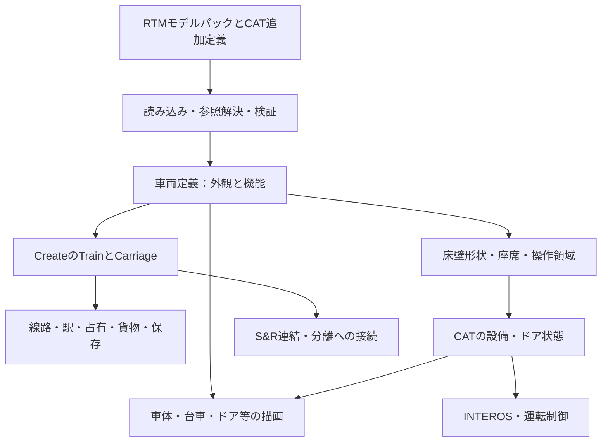

# RTMモデルをCATのCreate列車として使用するための構成調査

調査日：2026-10-18（日本時間）  
状態：調査報告・設計候補。採用済み仕様、実装開始の承認、動作保証ではない。

## 1. 結論

**Createの本物の列車を土台にし、RTMから外観・部品・設定を取り込み、CAT用の追加データで床・壁・座席・ドア・運転設備を接続する構成が最も目的に合う。**

具体的には、Createの `Train → Carriage → CarriageContraptionEntity → CarriageContraption` を維持する。線路上移動、駅、占有、対応する貨物設備、列車保存などを利用し、CATが既に担当すると決めた運転制御・ドア権限・INTEROSへ接続する。読み込んだモデルを表示するだけでは、車内歩行・着席・開閉可能な出入口にはならない。

追加データを許容し、RTM完全互換を必須にしない今回の条件は有効である。旧JavaScriptやRTM列車Entityまで再現する必要がなく、**モデル資産の読み込みと、CAT上での列車の振る舞いを分けられる**。

提供されたE235パックはMQO・材質別画像・宣言的ドア設定を持ち、具体的な取込み対象にできる。座席キーと提供RTM版の不一致候補、ドア設定の重複、外部資産の不足も見つかった（§4.4）。

ただし、ソースの接続先が分かることと、ゲーム内で正常動作することは別である。特に小数位置の座席、動的当たり判定、ポータル、半透明描画、連結時の状態移行は、後日の実装・実機検証が必要。

## 2. 調査対象と既存要件

### 2.1 調査方法・対象版

| 対象 | 今回確認した範囲 |
| --- | --- |
| CAT | Minecraft 1.20.1 / Forge 47.4.10 / Java 17 / Create 6.0.8-289。`gradle.properties`で確認 |
| Create | `vendor/Create-mc1.20.1-6.0.8` のJavaソース |
| Steam ’n’ Rails（S&R） | `vendor/Create-Steam-'n'-Rails_1.20.1_CreateV6`。`gradle.properties`は1.7.3、Create 6.0.8-289 |
| RTM | 利用者提供の `vendor/RTM/RTM2.4.24-43_forge-1.12.2-14.23.2.2611.jar` |
| NGTLib | 利用者提供の `vendor/RTM/NGTLib2.4.21-38_forge-1.12.2-14.23.2.2611.jar` |
| モデル例 | 利用者提供の `vendor/RTM/Usanolf_E235_2.1.0.zip` |
| 描画の既存例 | 別チェックアウト `C:/Products/Minecraft-CreateAddons/CreateCarriageShells` の現行ソース・資料。CATの採用仕様としては扱わない |

RTM・NGTLibの両JARには `.java` が含まれていない。設定・モデル・スクリプトはアーカイブから読み、Java処理はJDKの `javap -p -c` によるクラス宣言・バイトコードの静的解析で確認した。**原Javaソースを読んだという意味ではない。** JAR・モデルスクリプトの実行、Minecraft起動、ビルドは行わない。

提供版は、調査時点の作者配布ページで1.12.2向けの最新掲載版と一致する。別Minecraft版や非公式派生版の最新性とは区別する。[RTM配布一覧](https://www.curseforge.com/minecraft/mc-mods/realtrainmod/files/all)、[NGTLib配布一覧](https://www.curseforge.com/minecraft/mc-mods/ngtlib/files/all)。外部ソースをオンライン取得する代わりに、提供されたローカル資料を解析した。

### 2.2 「整理3.md」との接続

根拠は [整理3.md](../../整理3.md)。次の決定を維持して案を評価した。

| 整理3の決定 | 今回の構成への反映 |
| --- | --- |
| §2：CATと重複する速度制御は置換。経路・占有・駅状態・線路上移動と区別する | モデル読み込みを理由にCreateの運転制御を復活させず、無関係な機能へ介入しない |
| §2：標準運転台とCATマスコンの併設禁止 | 組立検査を通すために隠れた標準運転台を生成する案は採らない |
| §2.1–2.2：台方向・主副・編成方向の区別、最外側台、連結分離時の方針 | モデル前方、号車方向、編成順、運転台方向を別の情報として持つ |
| §3.4：ATO保持、TASC引継ぎ保持、ドア連動保持を区別 | ドア全閉でドア由来の保持だけを終え、他の保持・EBを解除しない |
| §11.19–11.21：運転手／車掌／閲覧、開扉条件、戸閉確認、自動化 | モデルの操作箇所もINTEROSを通る同じ要求経路へ接続する |
| §11.16：車体の揺れと視点、§13.11：尺度・台車デザインなど | 外観変換に備えるが、物理への適用や数値をこの調査で確定しない |

「通常のCreateでできることを全て可能にする」は、**標準列車が持つ非重複機能を失わせない目標**と解釈した。CATが既に置換すると決めた操作・速度制御まで標準挙動へ戻す意味にはしていない。対象ドアの種類、閉扉側別／全体、途中反転、故障時、ドアなし列車など、§14.3の未決事項は未決のまま残す。

## 3. 推奨する構成案

### 3.1 責任の分離

| 層（仮称） | 担当 | 担当させないもの |
| --- | --- | --- |
| RTM読込・変換 | モデル、UV、材質、部品名、テクスチャ、利用可能な設定の解釈 | 旧RTMの列車制御・任意JavaScriptの全面再現 |
| 車両定義 | 座標系、形状、座席、ドア、台車、設備、追加ブロックとの接続 | 走行中の指令や権限の正本 |
| Create接続 | 駅組立、号車、乗客、荷役、actors、保存、ポータルとの接続 | 既存機能をRTM専用の別実装へ複製すること |
| CAT設備・ドア | サーバー上の設備状態、要求受付、閉鎖確認、所属 | 描画進行率だけを根拠にした発車許可 |
| 描画 | 車体・台車・可動部・灯火・表示・透明窓 | 当たり判定、実際の速度・運転権限の決定 |
| S&R接続 | 編成変更の検知・前後処理、CAT状態の継承 | モデルの連結器位置だけによる連結成功判定 |

これらは責任分担の候補であり、Javaのクラス名やパッケージ構成を決定したものではない。

### 3.2 比較した方式

| 方式 | 評価 |
| --- | --- |
| 普通のCreate列車へ外装だけ表示 | 描画の初期確認には有効。ただしモデル内の床・椅子・扉の機能化が欠け、今回の最終目標には不足 |
| **Createの実車両＋モデル＋機能定義＋必要な実ブロック** | **推奨候補**。標準列車の荷役・作業機器などを残し、モデル固有部分だけ拡張できる |
| RTMの列車Entityを1.20.1へ移植し、Createの列車らしく見せる | 駅・占有・保存・貨物・アドオン連携まで二重に実装する範囲が増える。今回の目的には不利 |
| Create列車内部の全ブロックをなくし、全機能を仮想設備化 | 柔軟だが標準のactors・収納・操作・保存を接続し直す範囲が大きい。最初から全面採用する理由は弱い |

「機能定義」は床まで1ブロック厚にする意味ではない。細かな当たり判定や座席位置をモデルへ合わせながら、標準機器は実際のCreate対応ブロックとして残せる構成を目指す。

## 4. モデル読み込みと追加データ

### 4.1 読み込み方針

入力形式とCAT内部形式を分離する。RTMパックを取り込む入口と、将来CAT専用データを直接読む入口が、同じ車両定義へ到達する構成がよい。

- 読めるメッシュ・材質・設定は再利用し、車両の機能を表す追加JSON等を別に付ける。
- 読込時に部品名を保持する。扉・台車・パンタグラフ等を動かすには、頂点と材質だけでは足りない。
- 旧スクリプトは、利用している機能を確認し、CATの宣言的な動作定義へ置き換える候補とする。任意JavaScriptをそのまま動かすことを読み込みの前提にしない。
- RTMの走行性能値をCATの性能プロファイルへ無断採用しない。外観・設備と性能は別に対応付ける。
- 未対応形式・未解決部品・欠落テクスチャ・重複設定を検出し、どの機能が不足するか示す。黙って一部を無視して「対応済み」にしない。

直接読込でも事前変換でも、同じ正規化処理を使える。原パックをそのまま保存し、CAT側の追加定義だけを管理する運用が可能。変換済み資産の配布や他MODへの転用条件は各モデルのreadmeに従って別途確認する。

### 4.2 追加する情報の候補

| データ | 用途・必要性 |
| --- | --- |
| 定義ID、定義版、依存資産、出典 | 同名ファイル衝突、欠落、クライアントとサーバーの不一致を検出 |
| 原点・前後上下軸・単位・変換 | RTMモデル空間、Create号車空間、ワールド空間の対応。MQO等の入力単位変換とCAT世界の尺度設定を区別 |
| 車体・部品・材質・描画種別 | 不透明／切抜き／半透明／発光、内外表示、窓、可動部 |
| 静的な床・壁・屋根・設備の箱群 | 車内歩行、薄い壁、段差、二階建て床、出入口の開口 |
| 座席ID、位置、向き、操作領域、降車候補 | 小数座標での着席、同じセル内の複数席、通路へ降りる処理 |
| ドアID、種類、実側・外向き、部品、移動量・軸、動作時間、状態別形状 | 外観と通行判定と戸閉確認を同じ状態へ結び付ける |
| 運転台／車掌設備ID、位置、向き、設備種別 | CATの既存操作権・主副・最外側判定・HUDへ接続 |
| 台車種別、基準点、車体との対応 | Createの実台車と外観台車を対応。可動台車を車体へ固定描画しない |
| 車端・連結器の外観位置、貫通路 | 見た目の連結・隙間・可動幌。S&Rの判定点とは分離 |
| 標準ブロックの取付位置・利用空間 | 座席、収納、タンク、荷役口、作業機器等を本物のブロックで載せる |
| 表示・音の状態対応（必要なもの） | 行先、灯火、警笛等をCAT/Createの状態へ対応。専用音源の不存在を扱う |

上表の全項目を毎回手入力する必要はない。既存設定から読める項目は取込み候補として提示し、不足する当たり判定・役割・操作位置だけ補う。部品名だけから「この扉は安全確認対象の乗降扉」と断定しない。

配置例は `assets/<namespace>/...` に描画資産、サーバーから利用できる定義領域に車両機能データを置く形。厳密なフォルダ名・JSONキー・配布方式は未決定。**クライアントのリソースパックだけに衝突・着席・ドア機能の正本を置かない。**

### 4.3 提供JARから確認した互換範囲

NGTLibのモデル読込はOBJ・MQO・MQOZ・NPMへ分岐する。RTMはその前段でCLASS・NGTO・NGTZも扱う。このため、RTM対応を「OBJを読めばよい」とする構成は不十分である。（R1）

| 対象 | 確認事実とCATでの扱い案 |
| --- | --- |
| MQO | 今回の実例。NGTLibは座標を0.01倍し、オブジェクト名・UV・材質番号等を扱う。形式をCAT内部メッシュへ正規化する初期対象の候補 |
| OBJ／MTL | NGTLibはOBJのgroup/object名とMTLの材質名等を読む。テクスチャ割当はRTM設定も必要。拡張対象にしやすいが、未試験形式を対応済みとはしない |
| MQOZ | ZIP内のMQOを読む経路。MQO読込器と資産解決を共有できる候補 |
| NPM | 専用形式で、MD5情報との照合経路がある。通常MQOと同じ無条件読込の扱いにせず、正規の読取条件と必要情報を別に確認 |
| CLASS | 提供版の経路はModelBogie等の組込みモデルMap参照。任意Javaクラスを汎用メッシュとして読む機能ではない。必要な外観を個別に置換する候補 |
| NGTO／NGTZ | RTM側に別分岐があることを確認。今回のE235には使われておらず、完全対応の調査対象には広げていない |
| JavaScript・shader | RTMオブジェクト、旧Javaクラス、旧OpenGL等への依存を持ち得る。宣言的なCAT部品動作へ変換する候補。任意スクリプト互換は別規模の課題 |

NGTLibのScriptUtilはLaunchWrapperとNashorn互換初期化を使用し、Javaオブジェクトをスクリプトへ渡す。描画もGL11やMinecraft 1.12側のAPIを直接呼ぶ。したがって、JavaScriptエンジンを追加するだけで1.20.1上の互換性が得られる構造ではない。**RTM／NGTLib本体をCAT実行時の前提MODとせず、必要な資産解釈をCAT側に実装する候補**が適する。（R2）

モデル設定には描画用範囲 `renderAABB` と衝突部品指定 `collisionParts` が別に存在する。RTMの衝突は部品から面を集め、法線条件等で選別する経路を持ち、単純な車体全体の箱だけではない。確認した衝突イベント経路はPlayerを対象にする。CATではこの旧処理をそのまま移さず、床・壁・扉などの機能形状へ整理する。（R3）

RTM自身には着席処理もある。内部の座席配列の4番目は種類であり、向きではない。type=0では乗車処理を飛ばし、非0にはプレイヤー乗車処理がある。**「RTMというMODには着席機能がない」とは結論しない。** 今回の不便さはCAT側で改善する目的として扱い、体験した不具合の原因特定と分ける。（R4）

### 4.4 E235パックの実データと具体的な問題

対象は [Usanolf_E235_2.1.0.zip](../../../vendor/RTM/Usanolf_E235_2.1.0.zip)。アーカイブを変更せず検査した。

| 項目 | 結果 |
| --- | --- |
| ファイル数 | 236ファイル：車両JSON 45、MQO 21、PNG 166、JS 3、readme 1。ディレクトリを含むエントリ総数253 |
| 車体 | 45定義が12種類のMQOを参照。全て `trainModel2`、車体 `rendererPath` は未指定 |
| 台車 | 全定義で `DT61.mqo` と `DT61.js`。位置は `[0,0,7]` と `[0,0,-7]` で、間隔14。この実例の台車間隔自体は整数制約と衝突しない |
| 客席の宣言 | 通常車43定義は各28件、二階建て車2定義は各88件の `slotPos`。全1,380行の第4値は2。ただし下記の設定キー不一致に注意 |
| ドア | 全定義に `door_left`／`door_right`。有効定義から参照する180件の部品名はMQO内に存在 |
| 行先 | Sukaの15定義に画像・表示名・表示面の設定あり |
| 音 | 全45定義が外部の `MugenLib_E235-Mitsubishi.js` を参照 |

**A. 座席キーと対象RTM版の不一致候補**

パックは `slotPos` を使うが、提供RTMの `VehicleBaseConfig` が持つ配列は `seatPosF` と旧 `seatPos`。クラス宣言・注釈・JSON取込経路の確認では `slotPos` への別名指定がなく、通常のGson変換を使う。認識する二つのキーがない場合、標準初期化は長さ0の座席配列を作る。**確認した通常の読込経路では、このパックの28席／88席の指定は座席配列へ反映されない。** モデル上の椅子と実際の座席が一致しない具体的な原因候補である。（R4・R5）

CAT読込器では、この `slotPos` を明示的に互換入力として扱い、利用者へ「旧パックの位置指定を取り込んだ」と分かるようにできる。座席の向き、実際の腰位置、降車位置・操作領域は追加確認する。今回は元JSONを書き換えておらず、RTMでの再現試験もしていないため、れんさんの体験した原因がこれ一つであるとは断定しない。

また、45定義には `collisionParts` もない。提供RTMの通常初期化では欠落時に `-all` を補完せず、モデル由来の衝突面を選択しない経路になる。車両・台車・床など別の衝突処理まで存在しないという意味ではないが、モデル内の床壁をそのまま歩行形状として利用できるとの前提は成立しない。（R3）

**B. 一つのモデル部品が、一つの出入口とは限らない**

通常先頭車 `assets/minecraft/json/Suka/ModelTrain_f235f01.json` 81–95行では、`door_right` が `door_L1/L2`、`door_left` が `door_R1/R2`を動かす。部品名のL/RだけでCATの実側を決めると誤る。

対応MQOのドアグループは車体長手方向に広がり、複数箇所の戸をまとめて持つ。したがって、描画部品の指定は再利用できても、個々の出入口の操作・通行判定・閉鎖状態を管理するには、**出入口単位のIDと領域を補う必要がある**。初期対応で側単位に同時動作させる場合も、各出入口を通れるかは別に定義する。

**C. ドア設定の重複**

`assets/minecraft/json/Suka/ModelTrain_f235f04.json` は81行と89行に `door_left` が重複し、移動量が±0.80と±0.70で異なる。45JSONの検査で見つかった重複はこの1件。読込診断で明示し、正しい値を確認する。元RTMがどちらを採用するかを今回ゲーム上で検証したものではない。

**D. 提供一式にない依存資産**

次はモデルZIPだけでなく提供RTM・NGTLibの両JARも照合し、不在を確認した。

- `assets/minecraft/scripts/MugenLib_E235-Mitsubishi.js` と `assets/sound_mugenlib/` の音資産。readme 23行はMugenTrainSoundLibを前提として記載している。
- `assets/minecraft/usae235/light/blight.png`。43車両定義が参照する。似た画像名を同じ資産と推定して差し替えない。

車体・台車モデル、ボタン・行先画像、上記以外のJSON直接参照画像はZIP内に存在した。モデル表示やドアの構成調査を続けるには十分だが、提供一式だけで元パックの音や全ての発光表現を再現できるとはいえない。

**E. 二階建て・MQO・台車スクリプト**

グリーン車の座席宣言は、Y=−0.2に16件、−0.86に36件、0.9385に36件。床・階段・通路を含めると、Createの一段の床と標準座席だけを手置きする方式では一致させにくい。小数位置の席と形状定義を扱う構成の必要性が具体的に確認できた。

MQOにはミラー、depth、visible等の属性がある。NGTLibの該当パーサーは `mirror_axis` を読み、鏡像面を追加する一方、確認した経路ではdepthやvisibleに対応する分岐がない。**一般のMQOツールの表示と、このRTM版の表示は同一と決め付けない。** CAT取込時はRTMでの意味を再現するか、汎用MQOとして評価するかを明示する。DT61の元頂点はほぼ半身なので、ミラーを無視すると片側が欠ける。（R6）

通常先頭車 `kura/e235tc1.mqo` は宣言上10,072頂点・15,362面・106オブジェクト。これは変換・ミラー展開前の資料上の数で、描画後の三角形数や実寸の確定値ではない。材質内には作者環境の絶対パスもあり、パック内のJSON指定で資産を解決する。画像はこの例では `assets/minecraft/usae235/` にあり、常に `textures/` 下とは限らない。

`DT61.js` は車輪グループ `wheel1/wheel2` を中心 `(0,-0.53,±1.10)`、X軸で回し、RTMの車輪回転量と旧GL11を使う。CATでは「対象部品・回転軸・中心・Create由来の回転量」の定義へ置き換えられる候補。パンタグラフには部品形状があるが、対象JSONに昇降定義は確認できず、昇降まで自動対応とはしない。

### 4.5 取り込み・配置の利用手順案

1. 利用者が所持するモデルパックとCAT補助定義を指定する。
2. 読込診断で欠落・重複・対応できないスクリプト・寸法を確認する。
3. 車種・号車・向きを選び、車体と台車、床・出入口・席をプレビューする。
4. Createの組立領域へ必要な台車・機能構成を配置する。手置きの標準機器も追加できる。
5. CAT運転設備、必要な車掌設備、性能プロファイルを設定し、駅で組み立てる。
6. Create列車として運転し、S&Rを使う場合は既存の連結器設備から連結する。

配置の自動生成と、利用者が作った車体へモデルを付ける操作のどちらを初期UIにするかは未決定。解除後の再編集・アイテム返却・コスト・取消も仕様化が必要。

このモデルのreadme 5行は改造の有無にかかわらず再配布を認めない旨、9行は収益化動画とその他の商業利用を認めない旨を記載している。CATに元モデルや変換物を同梱することを前提にせず、ローカル取込みと補助定義の分離を候補とする。これは同封資料の記載と構成への含意であり、公開配布の許諾を確認したものではない。

## 5. 当たり判定の改善

### 5.1 五つの役割を分ける

| 判定 | 標準Create側の構造・今回の扱い |
| --- | --- |
| 車両全体の外接範囲 | 候補のプレイヤー等を抽出するAABB。大きくしただけでは車内の床や窓穴にならない |
| 人・Mobと床壁ドアの衝突 | `ContraptionCollider`のローカル形状処理を利用する候補。今回の改善の中心 |
| 座席・ボタン等の選択 | クリック用raycast。物理衝突形状と別に調整し、遠方・反対側の設備へ誤操作しない |
| 列車同士の衝突 | `Train`のTravellingPoint間の線分等による処理。車体メッシュやクリック領域を変えても自動では変わらない |
| 列車車体と地形の衝突 | 汎用地形衝突はTranslatingContraption向けで、CarriageContraptionとは別。リアルな車両限界・トンネル接触を今回当然の追加対象にはしない |

根拠：C1・C3・C4。車内を歩けることと、隣接列車への接触やトンネルへの物理衝突を完全再現することを混同しない。

### 5.2 推奨候補と接続上の難所

床・壁・屋根・出入口を簡素な箱群で表し、近傍セル単位で調べる構成を推奨する。描画用の全三角形を毎tick衝突判定に使う必要はない。整数セルで管理しても、セル内の形状寸法は小数にできる。薄い床・壁、段差、窓の開口を表現できる。

ただし、通常のBlock Entityに形状JSONを保存し、`getCollisionShape`から参照すれば完成する構造ではない。

1. Createは形状を非同期で収集し、簡略AABBをキャッシュする。
2. キャッシュ不使用時の形状取得と、クリック用形状取得は別経路である。
3. 仮想ワールドから任意の車両内Block Entityデータを取れるとは確認できず、通常raycastには固定位置を渡す箇所もある。
4. ポータル通過中は簡略colliderを使用しないため、通常時だけへの接続では不足する。

このため、**CAT車両のローカル形状を一貫して渡す仕組み**を設け、キャッシュ・個別形状・クリック・ポータルへ対応させる案が有力。有限種類の形状を不変のBlockStateに収められる部分は、標準の経路を利用できる。

開閉ドアなどの変更では、サーバー確定状態と同じ版の形状を使い、キャッシュを更新する。非同期計算で古い閉ドア形状が後から復活しないようにする。標準部品との二重衝突、同じセルを占有する追加設備との競合、段差・高速移動・低TPSでのすり抜けは後日の重点検証対象。

## 6. 着席・車内移動

Createの標準座席は `List<BlockPos>` と乗客UUID→座席indexで管理し、位置をブロック中央基準で求める。したがって、**椅子メッシュが存在しても座れるわけではなく、小数座標の多数の席を標準の位置一覧へ追加するだけでも足りない。**

推奨候補は、安定した座席IDと小数位置を追加定義し、乗客をCreate車両の乗客関係へ結び付けること。座席index、位置計算、クリック、同時着席、降車、安全な降車先、保存・復帰を一組で扱う。既存の標準Seatをそのまま使いたい場所は、その経路を残す。

標準の「着席プレイヤー数」条件は `Train.countPlayerPassengers()` を通じて各車両の間接乗客を数える。車両と無関係な独立座席Entityだけを作ると、この条件や次元移動・保存から漏れる可能性がある。車内を立って歩く人を標準の着席数に無断で加算しない。Mobの乗車、プレイヤー優先の席利用も対応確認が必要。（C2・C5）

車内の歩行と連結部の通り抜けも別の検証項目とする。車内床を作れても、別々に回転する号車間の貫通路が曲線で安全に渡れることまでは証明されない。可動幌の見た目と橋渡し床の衝突を別に設計する必要がある。

## 7. ドア・操作設備

### 7.1 描画・通行・戸閉確認を一つの状態に接続

CATのドアには、例えば `CLOSED / OPENING / OPEN / CLOSING / UNKNOWN` のようなサーバー状態と進行情報を持たせる案が適する。故障や途中反転の分類は後で決める。同じ状態を次へ渡す。

- モデル部品の描画位置。
- 実際に通行できる開口・ドアの当たり判定。
- 全開／全閉の確認、戸閉灯、時刻表子条件。
- INTEROSの力行禁止・ドア由来保持・異常検知。

Create標準ドアはサーバーの `OPEN` 変更と、クライアントのアニメーションが分かれる。`OPEN=false`だけでは、閉動作アニメーション完了を証明しない。標準ドアをCAT管理対象にする場合も、同じ水準の完了判定へ接続する必要がある。（C6）

開閉途中のどの時点で通行可能にするか、挟み込み検知を実装するか、開閉中の反対要求は未決定。戸閉命令を送った瞬間に通行判定や戸閉灯だけ先行させない。

### 7.2 操作の入口と左右変換

標準ドアの駅自動開扉・直接クリック、S&Rのドアモード、CATの車掌HUD・ATOが独立に状態を書き換えると競合する。CAT管理対象ではこれらを要求としてINTEROSへ渡す。S&RのSPECIALモードもShiftクリックを許すため、CATの権限管理の代替にはならない。管理外の普通のドア・列車へ一律介入する必要はない。（C6・S3）

Createの駅開扉設定は、単なる左右ではなく `ALL / NORTH / EAST / SOUTH / WEST / NONE`。ドアに車両ローカル外向きベクトルと役割を持たせ、駅の方角、実車両の左右、選択台から見た左右を変換する。レバーサー前後で左右を反転しない。駅情報が取得できない場合は推測開扉せず、整理3の待機規則へ従う。（C7）

乗降扉と、乗務員室扉・車内仕切り・貫通扉を区別できるデータが必要。全ての可動ドアを無条件に同じ安全確認対象へ入れるかどうかは、現在の未決事項として残す。

### 7.3 組立時にもCAT運転設備の接続が必要

Createの `CarriageContraption` は標準Train Controlsブロックを直接認識し、駅は前向き運転台がないと組立を拒否する。CATマスコンの見た目を描くだけでは運転設備として認識されない。組立時の検査、運転可能方向、必要なconductor判定へCAT設備を接続する。隠れた標準運転台で検査を回避する案は、整理3の併設禁止に反する。（C1・C8）

## 8. 台車・連結・編成変更

### 8.1 モデル寸法とCreate走行構造

標準の一つのCarriageは原則1～2台車で、1台車を認めるかは台車種別にも依存する。台車間隔・駅組立の車両間隔は整数で管理される。外観の小数位置は描けるが、それだけで走行上の台車間隔や連結間隔が同じ小数値になるわけではない。（C1・C8）

実台車とモデル台車を対応させ、曲線時の台車旋回は実台車の姿勢に追従させる候補とする。次の選択は未決定。

- モデル寸法を標準Createの組立寸法へ合わせる。
- 実台車は整数位置、外観には調整差を持たせ、その許容範囲を決める。
- 小数間隔そのものを物理構造へ反映できるよう追加拡張する。

「車体を縮尺変更すれば、内装・台車・座席・連結・ホーム高さも自動的に全て整う」とはしない。10両・11両等の長編成は、標準の組立長・台車数Configも確認対象になる。CATの全体尺度や性能プロファイルの議論と結び付くが、この報告では値を確定しない。

### 8.2 三種類の「連結」

| 種類 | 確認した位置付け |
| --- | --- |
| Create駅で複数号車を一列車に組み立てる | 標準機能。Carriage一覧とspacingからTrainを作る |
| Createのcouplingコマンド | 対象はAbstractMinecart。通常の列車同士の動的連結APIとは扱えない |
| S&RのTrack Couplerで組立済み列車を連結・分離 | 利用候補。台車のTravellingPointと編成端を利用し、RTMの連結器メッシュは参照しない |

S&Rには先頭と末尾の組合せ条件があり、先頭同士・末尾同士を自由に反転接続する機構ではない。モデルに連結器の位置データを追加しても、この向き制約は消えない。逆向き自由連結を希望する場合は別の拡張判断になる。（S1）

### 8.3 整理3とS&Rの時刻表引継ぎの差

| 場面 | 提供S&Rソースの動作 | 整理3のCAT方針への接続 |
| --- | --- | --- |
| 継続側に時刻表がない連結 | 相手側の時刻表runtimeを移す | 常に同じ動作を採用できるとは限らず、CATの「継続側を採用」と整合させる |
| 両側に時刻表があり継続側が完了済み | 継続側を返却し、相手側を採用する分岐がある | 継続側優先というCAT方針との相違 |
| 分離 | 時刻表を渡した車両indexが後部分なら、新列車へruntimeを移す | 継続側のみ保持し分離側へ移さないCAT方針との相違 |

一般的な一回の連結実験だけでは、これらの例外分岐は確認できない。CAT管理列車限定の接続で引継ぎを制御する必要がある。これは整理3の利用者報告を否定する意味ではなく、標準実装には追加条件があるという調査結果である。（S2）

連結で前側Train UUIDが残り後側が削除され、分離で新UUIDが作られる。Carriage実体は移され、indexは変わる。`Carriage.id`も永続IDではない。**実物車両UUIDと、車両内の設備・席・ドアID**を定義ID・列車UUIDから分けて保持する候補が必要。

S&Rの処理は全車両で利用可能なEntityを要求し、失敗しても元Trainを返す経路がある。戻り値の存在だけを成功通知にしない。変更後の所属・順序・方向、最外側台、主副、操作担当、ドア状態、時刻表・予約を更新してからATO発車判定へ進める。未決の継承規則まで自動決定しない。（S2・C9）

## 9. 標準Create列車機能を残すための対応表

「維持候補」はソース上の接続方針であり、検証済みの対応宣言ではない。段階的に試す場合も、最終目標から黙って削除しない。

| 機能 | 構成案・確認点 |
| --- | --- |
| 線路上走行、曲線、勾配、分岐 | CreateのTrain/Carriage/TravellingPointを維持。車体と台車の姿勢を合わせる |
| 駅組立、解除、再組立 | 機能構成を実際に捕獲・復元。モデルID・車両個体・設備情報の保持と組立エラーを設計 |
| 手動運転、両方向運転 | CAT運転設備を組立検出と方向情報へ接続。操作・制御は整理3に従う |
| スケジュール運行、駅待機条件 | CATの既定方針を維持。標準の貨物量・着席数・駅条件等が正しい実体を参照することを確認 |
| 信号占有、経路、駅予約、表示 | Create側の実体を維持。模型だけの別列車として管理しない |
| Player/Mob着席、降車 | 標準Seatを維持し、モデル席は乗客ツリー・index・保存へ接続 |
| 車内歩行・乗降 | 床・壁・開口・ドア形状。移動床の追従、段差、車間通路を検証 |
| チェスト・樽等の対応収納、タンク | 本物の対応ブロックとCarriageのMountedStorageを使用し、別の複製在庫を作らない |
| Portable Storage/Fluid Interfaceによる荷役 | 実ブロックを取付け、既存MovementBehaviourを維持。外観で接続口を塞がない |
| 対応するドリル等の作業機器 | 標準の列車上で働くactorをそのまま接続。モデル由来の機能部品へ全部置換しない |
| 標準の機能ブロック・通常車両との混成 | 取付空間と衝突を両立。混成時も標準運転台併設禁止などCAT判定は編成全体へ適用 |
| 警笛、灯火、行先、車内表示、音 | 標準機能を残し、モデル表示は必要な状態へ対応。未提供音源を新しい音として捏造しない |
| ドアと駅設定 | 標準対象も含めCATの受付・完了確認へ統合。管理外の列車への影響を避ける |
| 脱線、レンチ復線・再配置 | Createの経路を維持し、モデル・席・設備を追従。CAT復旧状態との接続は既存残課題 |
| 未読込区間、保存、再起動 | 生Entityの存在だけへ依存しない。Carriageの永続状態とモデル定義を再結合 |
| ネザーポータル等の次元跨ぎ | 車体・台車・ドア形状・選択領域の部分表示と乗客移送を対応させる |
| マルチプレイ | サーバーが操作・形状・席占有・ドア状態を確定し、クライアントは補間表示 |
| S&R連結・分離、他の鉄道アドオン | 標準実体を保つことは基礎。値の意味・更新時期・編成変更を個別検証し、全アドオン互換を宣言しない |

標準列車は全Minecraftブロックの通常ワールド動作を再現するものではない。確認した実行経路は主に対応するmounted storage・登録済みMovementBehaviour等である。任意のレッドストーン回路やあらゆるBlock Entityを新たに移動中稼働させる課題へ、この機能を広げない。（C2・C10）

## 10. 描画・ポータル・保存で見落とせない点

### 10.1 描画

通常の描画経路とFlywheel経路、台車描画、半透明窓、内側からの可視性、昼夜の灯火、描画距離、他の透明物体との前後関係を確認する。多角形数の多いモデルを毎フレーム作り直さず、静的メッシュを共有し可動部の変換だけ更新する候補が適する。負荷上限は実測後に決める。

車体揺れを見た目だけへ追加すると、足元・座席・クリック位置とずれる可能性がある。整理3の揺れ・カメラ方針と整合する変換を設計し、Createの曲線姿勢と二重適用しない。

### 10.2 ポータル

アンカーブロック一個の通常Block Entity Rendererで外装全体を描く方式では、アンカーがポータルで隠れるかどうかにより車体全体を表示／非表示にするだけになり得る。車体の途中で切る処理は別に必要。描画範囲を大きくするだけでは解決しない。（C11・L1）

Createが持つ次元別の可視区間をモデルにも適用し、衝突・クリック・乗客処理も一致させる。「一両が二つの次元にまたがる」状態を受入条件に含める。

### 10.3 保存・同期・定義更新

定義IDと版、実物車両ID、設備ID、座席対応、ドア状態・進行・不明状態を適切に保持する。描画Entityの消失を機器の破壊や全閉確認と見なさない。再接続・保存再開で座席やドアを別個体と取り違えない。

描画資産が欠けた場合と、サーバー機能定義が欠けた場合を分ける。定義更新で走行中の床や座席を突然変えないよう、版固定・再組立時更新・停止中更新等の方針を後で決める。クライアント不足時の代替表示、新規組立の拒否、既存列車の救済も設計対象。更新失敗を空の車両や正常な全閉へ読み替えない。

## 11. 既存CreateCarriageShellsから参考にできる部分

別プロジェクトには、号車の基準ブロック、モデルID保存、OBJと描画の分離、リソース再読込、車体への追従描画がある。ただしモデル衝突・座席接続・可動ドア・ポータル部分切断は実装されていない。

既存OBJパーサーは `o` / `g` を無視するため、扉等の部品名を保持する今回の読込器へそのまま使用できない。MTLを解釈せず、テクスチャも一モデル一枚という制約がある。

現在のソースには窓の描画を後段へ回す変更があるが、ローカル文書の実機報告は「修正前は窓越しに床が消える問題」、修正後の実機確認は未実施と記録されている。今回も動作検証はしていない。参考にするのは構造と既知の課題であり、完成済みのRTM対応基盤とは扱わない。（L1）

## 12. 将来の実装順・受入確認案

この順序は実装開始の指示ではない。全体構成を判断し、別途承認後に進めるための提案。

1. **読込と事前診断**：提供モデル一車種を解析し、部品・材質・依存・寸法・不足設定を一覧化。まだ走行成功とは扱わない。
2. **Create一車両として成立**：駅組立・CAT設備認識・モデル追従・保存・解除・再組立を確認。
3. **実用的な車内**：床・壁・出入口、座席・降車、ドアの描画と通行形状を接続。
4. **運転・運用との接続**：戸閉確認、権限、INTEROS、駅側、ATO子条件、標準貨物・作業機器。
5. **境界の確認**：曲線・勾配、高速／低TPS、複数人、再接続、チャンク外、ポータル、混成編成、S&R連結・分離。
6. **対象モデル拡大・性能調整**：先頭／中間／二階建て、材質・音・表示の差分、Flywheel・軽量化MODとの組合せ。

最低限の受入ケースは、(a)閉扉中は通れず開扉後は通れる、(b)開閉中・不明を戸閉完了にしない、(c)椅子の見た目と実際の座り位置が合う、(d)標準着席数・貨物条件が正しく働く、(e)連結分離しても車両の席・ドア・設定を取り違えない、(f)保存再開・次元跨ぎで復元できる、(g)CAT管理外の普通の列車を変えない、を含む。

## 13. 判断が残る事項

| 判断 | 現時点の推奨候補／残課題 |
| --- | --- |
| 導入時の手順 | モデル＋追加定義から台車・論理構成を配置する方式と、利用者の台車・床へ追加する方式。前者が完成車両として扱いやすいが、アイテム・コスト・編集・組立取消を要設計 |
| 最初の互換範囲 | 提供MQOパックを具体例に、静的モデル＋宣言的可動部を優先。スクリプト／特殊形式は個別対応表を持つ |
| 床壁の精度 | 簡素な箱群を基本とし、細部を増やす上限を実測。装飾面全てに物理判定を付ける必要はない |
| 寸法・台車間隔 | 標準Createの整数間隔へ合わせるか、見た目の調整差を許すか、小数間隔を拡張するか |
| ドア対象と競合 | 整理3 §14.3①の未決事項。乗降扉／仕切り扉、閉扉範囲、途中反転、破損・不明、ドアなし編成 |
| 連結範囲 | S&Rの既存向き制約を維持するか、逆向き自由連結まで別途拡張するか |
| 車体揺れ・貫通路 | 外観・当たり判定・乗客の変換と車間の橋渡し。通常床の成功とは分けて確認 |
| 配布・定義更新 | サーバー機能定義とクライアント資産の供給、版不一致、欠落・更新時の扱い |

調査でこれらの採否を独断確定していない。既存の整理3をこの案で上書きせず、判断時に必要箇所を正式な要件へ反映する。

## 14. ローカルソース根拠索引

行番号は今回のvendorのもの。更新後は再確認する。CはCreateの `src/main/java/com/simibubi/create/`、SはS&Rの `common/src/main/java/com/railwayteam/railways/` 以下を指す。

| ID | 根拠 |
| --- | --- |
| C1 | [StationBlockEntity.java](../../../vendor/Create-mc1.20.1-6.0.8/src/main/java/com/simibubi/create/content/trains/station/StationBlockEntity.java) 770–875：組立、Carriage生成、運転設備検査、bounds、Train登録 |
| C2 | [Contraption.java](../../../vendor/Create-mc1.20.1-6.0.8/src/main/java/com/simibubi/create/content/contraptions/Contraption.java) 144–159、655–683：ブロック・seats・actors・interactors・storage |
| C3 | [ContraptionCollider.java](../../../vendor/Create-mc1.20.1-6.0.8/src/main/java/com/simibubi/create/content/contraptions/ContraptionCollider.java) 79–220、370–385、662–701；[Contraption.java](../../../vendor/Create-mc1.20.1-6.0.8/src/main/java/com/simibubi/create/content/contraptions/Contraption.java) 1430–1455；[ContraptionWorld.java](../../../vendor/Create-mc1.20.1-6.0.8/src/main/java/com/simibubi/create/content/contraptions/ContraptionWorld.java) 35–42；[ContraptionHandlerClient.java](../../../vendor/Create-mc1.20.1-6.0.8/src/main/java/com/simibubi/create/content/contraptions/ContraptionHandlerClient.java) 158–180：衝突と操作の別経路 |
| C4 | [Train.java](../../../vendor/Create-mc1.20.1-6.0.8/src/main/java/com/simibubi/create/content/trains/entity/Train.java) 598–700：列車間衝突；[AbstractContraptionEntity.java](../../../vendor/Create-mc1.20.1-6.0.8/src/main/java/com/simibubi/create/content/contraptions/AbstractContraptionEntity.java) 129–130、561–570：地形衝突対象とbounds |
| C5 | [AbstractContraptionEntity.java](../../../vendor/Create-mc1.20.1-6.0.8/src/main/java/com/simibubi/create/content/contraptions/AbstractContraptionEntity.java) 146–166、222–245、285–324；[Train.java](../../../vendor/Create-mc1.20.1-6.0.8/src/main/java/com/simibubi/create/content/trains/entity/Train.java) 1230–1238；[PlayerPassengerCondition.java](../../../vendor/Create-mc1.20.1-6.0.8/src/main/java/com/simibubi/create/content/trains/schedule/condition/PlayerPassengerCondition.java) 71–83：席・乗客・条件 |
| C6 | [SlidingDoorMovementBehaviour.java](../../../vendor/Create-mc1.20.1-6.0.8/src/main/java/com/simibubi/create/content/decoration/slidingDoor/SlidingDoorMovementBehaviour.java) 39–103、118–146；[DoorMovingInteraction.java](../../../vendor/Create-mc1.20.1-6.0.8/src/main/java/com/simibubi/create/content/contraptions/behaviour/DoorMovingInteraction.java) 21–62：ドア状態、クライアント補間、直接操作 |
| C7 | [DoorControl.java](../../../vendor/Create-mc1.20.1-6.0.8/src/main/java/com/simibubi/create/content/decoration/slidingDoor/DoorControl.java) 21–40；[DoorControlBehaviour.java](../../../vendor/Create-mc1.20.1-6.0.8/src/main/java/com/simibubi/create/content/decoration/slidingDoor/DoorControlBehaviour.java) 28–37；C6の171–204：駅方角と変換 |
| C8 | [CarriageContraption.java](../../../vendor/Create-mc1.20.1-6.0.8/src/main/java/com/simibubi/create/content/trains/entity/CarriageContraption.java) 94–127、151–185：台車数・運転設備；[Carriage.java](../../../vendor/Create-mc1.20.1-6.0.8/src/main/java/com/simibubi/create/content/trains/entity/Carriage.java) 64–76：整数台車間隔 |
| C9 | [Carriage.java](../../../vendor/Create-mc1.20.1-6.0.8/src/main/java/com/simibubi/create/content/trains/entity/Carriage.java) 56–78、250–307、451–524、687–755、838–863：ID、Entity管理、保存、乗客移送；[CarriageContraptionEntity.java](../../../vendor/Create-mc1.20.1-6.0.8/src/main/java/com/simibubi/create/content/trains/entity/CarriageContraptionEntity.java) 469–479：TrainId・index |
| C10 | C8の130–142、306–308：車両storage；[MountedStorageManager.java](../../../vendor/Create-mc1.20.1-6.0.8/src/main/java/com/simibubi/create/content/contraptions/MountedStorageManager.java) 150–184、410–423；[PortableStorageInterfaceMovement.java](../../../vendor/Create-mc1.20.1-6.0.8/src/main/java/com/simibubi/create/content/contraptions/actors/psi/PortableStorageInterfaceMovement.java) 65–149；[AbstractContraptionEntity.java](../../../vendor/Create-mc1.20.1-6.0.8/src/main/java/com/simibubi/create/content/contraptions/AbstractContraptionEntity.java) 375、435–465 |
| C11 | C8の252–303、357–372：ポータル可視区間・BER判定；[CarriageContraptionVisual.java](../../../vendor/Create-mc1.20.1-6.0.8/src/main/java/com/simibubi/create/content/trains/entity/CarriageContraptionVisual.java) 53–86、113–126；[ContraptionEntityRenderer.java](../../../vendor/Create-mc1.20.1-6.0.8/src/main/java/com/simibubi/create/content/contraptions/render/ContraptionEntityRenderer.java) 122–141；[ClientContraption.java](../../../vendor/Create-mc1.20.1-6.0.8/src/main/java/com/simibubi/create/content/contraptions/render/ClientContraption.java) 105–124、159–165 |
| S1 | [TrackCouplerBlockEntity.java](../../../vendor/Create-Steam-'n'-Rails_1.20.1_CreateV6/common/src/main/java/com/railwayteam/railways/content/coupling/coupler/TrackCouplerBlockEntity.java) 151–185、362–444；[Create CouplingCommand.java](../../../vendor/Create-mc1.20.1-6.0.8/src/main/java/com/simibubi/create/infrastructure/command/CouplingCommand.java) 31、48–71 |
| S2 | [TrainUtils.java](../../../vendor/Create-Steam-'n'-Rails_1.20.1_CreateV6/common/src/main/java/com/railwayteam/railways/content/coupling/TrainUtils.java) 72–181、245–321；[MixinScheduleItem.java](../../../vendor/Create-Steam-'n'-Rails_1.20.1_CreateV6/common/src/main/java/com/railwayteam/railways/mixin/MixinScheduleItem.java) 43；[MixinTrain.java](../../../vendor/Create-Steam-'n'-Rails_1.20.1_CreateV6/common/src/main/java/com/railwayteam/railways/mixin/MixinTrain.java) 272 |
| S3 | [MixinSlidingDoorMovementBehaviour.java](../../../vendor/Create-Steam-'n'-Rails_1.20.1_CreateV6/common/src/main/java/com/railwayteam/railways/mixin/MixinSlidingDoorMovementBehaviour.java) 37–44；[MixinDoorMovingInteraction.java](../../../vendor/Create-Steam-'n'-Rails_1.20.1_CreateV6/common/src/main/java/com/railwayteam/railways/mixin/MixinDoorMovingInteraction.java) 45–52 |
| L1 | 別チェックアウト [CreateCarriageShells README](../../../../CreateCarriageShells/README.md) 59–83、`docs/REQUIREMENTS.md` 28・59–60、`docs/TODO.md` 11–16。`src/main/java/dev/edudio/createcarriageshells/`の `model/ObjMesh.java` 59、`client/ShellRenderer.java` 19–50、`client/ShellGlassPass.java` 26–55、`ShellAnchorEntity.java` 12–31。ソース構造と過去の文書記録を確認したもので、今回の実機検証ではない |

### 14.1 RTM／NGTLibのバイトコード根拠

Rは [RTM JAR](../../../vendor/RTM/RTM2.4.24-43_forge-1.12.2-14.23.2.2611.jar)、Nは [NGTLib JAR](../../../vendor/RTM/NGTLib2.4.21-38_forge-1.12.2-14.23.2.2611.jar)。以下の番号はJavaソース行ではなく、`javap -p -c`で確認したメソッド内のbytecode offset。フィールド別名については `javap -v -p` で注釈も確認した。

| ID | クラス・メソッドと確認箇所 |
| --- | --- |
| R1 | N `jp.ngt.ngtlib.renderer.model.ModelLoader.loadModel(InputStream[],String,VecAccuracy,Object...)` 0–127：形式分岐。R `jp.ngt.rtm.modelpack.ModelPackManager.loadModel(String,int,boolean,ModelConfig,byte[])` 92–207：CLASS/NGTO/NGTZ。R `jp.ngt.rtm.modelpack.model.RTMClassModels.init()` 0–72、`getModel(String)` 0–26：組込みモデル |
| R2 | N `jp.ngt.ngtlib.io.ScriptUtil.init()` 0–24、`doScript(String)` 9–34：LaunchWrapper・JavaScript・Nashorn互換。`doScriptFunction(ScriptEngine,String,Object...)` 0–11：Javaオブジェクト引数を渡すInvocable呼出。N `jp.ngt.ngtlib.renderer.model.PolygonModel.renderAll(boolean)` 0–40：GL11等。R `ModelConfig$ModelSource` の宣言：renderer/shaderパス |
| R3 | R `jp.ngt.rtm.entity.util.CollisionObj.<init>(IModelNGT,ModelConfig)` 26–40、`initFaceList(IModelNGT,String[])` 0–175、static初期化0–6：collisionParts・全選択・面法線。R `jp.ngt.rtm.entity.util.CollisionHelper.onCollison(GetCollisionBoxesEvent)` 0–17、94–123：Player対象。R `jp.ngt.rtm.modelpack.cfg.ModelConfig` のコンストラクタ・`init()`：collisionPartsの既定補完なし、renderAABBは別項目 |
| R4 | R `jp.ngt.rtm.modelpack.cfg.VehicleBaseConfig` フィールド宣言、`init()` 168–297、`getSlotPos()` 0–4。R `jp.ngt.rtm.entity.vehicle.EntityVehicleBase.setupFloors()` 58–120：4番目はtype。R `jp.ngt.rtm.entity.train.parts.EntityFloor.func_184230_a(EntityPlayer,EnumHand)` 43–61、209–221：type=0の除外と乗車 |
| R5 | R `jp.ngt.rtm.modelpack.ModelPackManager.registerResourceSet(ResourceType,File)` 24–42；N `jp.ngt.ngtlib.io.NGTJson.getObjectFromJson()` 0–8、`getGson()` 6–19：通常Gson。R4クラスにはslotPosフィールド／SerializedName注釈なし |
| R6 | N `jp.ngt.ngtlib.renderer.model.MqoModel.getCorrectValue(String)` 0–9：0.01倍。`parseLine(String,int)` 64–124、262–431：mirror_axis、facet等。`postInit()` 0–51、`parseVertex`14–71：depth・visible・Object変換の解釈を確認できない。N `jp.ngt.ngtlib.renderer.model.Face.getMirror(...)` 7–217：鏡像面 |
| R7 | R `jp.ngt.rtm.render.BasicVehiclePartsRenderer.renderParts(float,VehicleParts,PartsWithChildren)` 3–183：支点、移動、回転、子部品。R `jp.ngt.rtm.render.VehiclePartsRenderer.getDoorMovement(Entity,int)` 19–42：doorMove/60。R `EntityVehicleBase.updateDoorAnimation(ModelSetVehicleBase,boolean,int)` 0–62：開閉進行 |
| R8 | R `jp.ngt.rtm.modelpack.cfg.TrainConfig.init()` 4–163：旧／新車体・台車設定、188–253：台車位置・trainDistance。R `jp.ngt.rtm.entity.train.EntityTrainBase.getDefaultDistanceToConnectedTrain(other)` 30–61：自車と他車のtrainDistanceを合算。`trainDistance`を全長へ無条件転記しない |

JSONのversion、RTMのNBT保存Version、CATが将来持つ定義版は別のもの。RTMの保存Version=43をCATモデル形式のスキーマ番号に流用しない。

### 14.2 モデルZIPの根拠

以下は全て `Usanolf_E235_2.1.0.zip` 内。行番号はテキストを読んだ際のもの。

| エントリ | 根拠となる範囲 |
| --- | --- |
| `assets/minecraft/json/Suka/ModelTrain_f235f01.json` | 7–50：モデル・材質・台車、54–67：音とslotPos、77–95：乗員点・台車・trainDistance・ドア、96–138：行先表示 |
| `assets/minecraft/json/Suka/ModelTrain_f235f04.json` | 44–59：88席宣言、69–95：台車・ドア。81と89のdoor_left重複 |
| `assets/minecraft/json/Suka/ModelTrain_f235f05.json` | 44–59：88席宣言、73–87：ドア。こちらに重複なし |
| `assets/minecraft/models/kura/e235tc1.mqo` | 1–3：形式・文字コード、537：材質数、20434／21380／22326／23272：ドアグループ |
| `assets/minecraft/models/kura/e234ts0.mqo` | 8377、8485、8795：床・座席の表示用オブジェクト名。機能登録ではない |
| `assets/minecraft/models/DT61.mqo` | 552–553、2158–2159、2798–2799：mirror/mirror_axis |
| `assets/minecraft/scripts/DT61.js` | 1–4：Java/OpenGL依存、8–10：部品名、21：車輪回転量、39・44：軸・回転中心 |
| `readme.txt` | 5：改変・再配布の記載、9：収益化・商業利用の記載、23：MugenTrainSoundLib、36・38・40：各素材の出典 |

同封のRTM／NGTLib `LICENSE.txt`にはJavaクラスのデコンパイルを認める記載がある。静的な処理確認と、ソース・モデル・音をCATへ同梱して配布できることは別であり、今回コピーして組み込む実装はしていない。

調査対象を再識別するためのSHA-256：

| ファイル | SHA-256 |
| --- | --- |
| RTM2.4.24-43 JAR | `32B5BFAC7A7EA90723FF0D89372EFCD392BCFBF7BFD1867E1D2DFA1874A4B62C` |
| NGTLib2.4.21-38 JAR | `7D4D17BDBAFE3262BB6BC2C28EF4E6E66F3B98EA0FC5AF14C8B45561954E00FF` |
| Usanolf_E235_2.1.0.zip | `4D248943BD07BC4D77B809545E9DD58F8C08C90FA30197B97E9EACF2FCB5C939` |

## 15. 検証状態

- 実施：整理3・現行作業規則の参照、Create／S&Rのソース読解、別プロジェクト描画例の確認、提供JARとモデルZIPの静的解析、配布版の公開情報確認、調査文書の整合確認。
- 未実施：実装、モデル変換物の生成、ビルド、Minecraft起動、描画・衝突・着席・運転・連結・マルチプレイの実機試験。
- 成果物はこの調査文書。既存実装・vendor原本・整理3の決定事項は変更しない。

